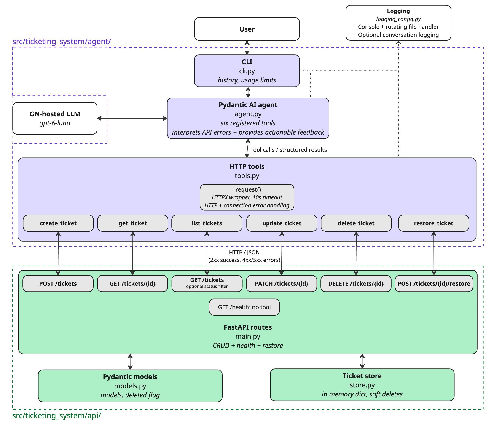
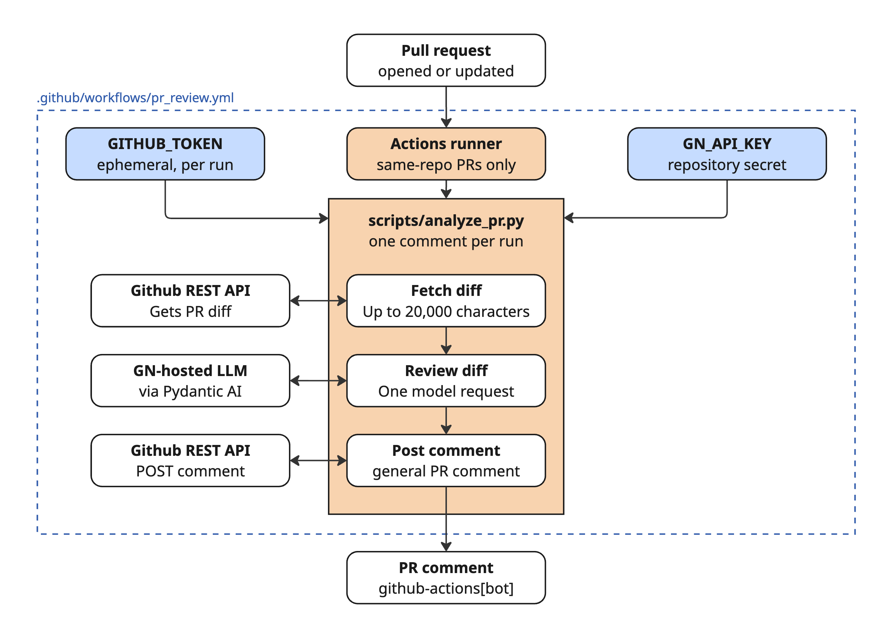

# GN Ticketing Agent

I prepared this project for GN's recruitment process, and I look forward to discussing it at the second interview! It includes a mock support-ticketing API, a natural-language agent, and an automated pull-request reviewer, as well as a Terraform skeleton.

To try it, start with the [installation instructions](#local-setup). For the big picture, see the [architecture overview](#stack-and-architecture). The implementation details are in [Part 1: Ticketing API](#part-1-ticketing-api), [Part 2: GenAI agent](#part-2-natural-language-ticketing-agent), [Part 3: PR review bot](#part-3-automated-pr-review), [Part 4: Azure Terraform](#part-4-azure-terraform-skeleton), and [Part 5: Production design decision](#part-5-optional-production-design-decision).

## Local setup

**Prerequisites:** Git and an authorized GN API key for live agent use. The recommended setup uses [uv](https://docs.astral.sh/uv/getting-started/installation/), which can install a compatible Python version. If you don't have or prefer not to use uv, see [Alternative installation: pip](#install-with-pip). Local tests and the mock API do not require the GN key.

### Install and run with uv

From a fresh clone, run these commands in macOS, Linux, or Windows PowerShell:

```bash
git clone https://github.com/leeonora/gn-ticketing-agent.git
cd gn-ticketing-agent
uv sync --extra dev
```

`uv sync` creates `.venv` and installs the project and test tools from `uv.lock`.

Start the API and agent together:

```bash
uv run gn-ticketing
```

If `OPENAI_API_KEY` is missing or still the example placeholder, the launcher asks for it with hidden input and saves it to `.env` for future runs. If `.env` does not exist, the launcher starts from `.env.example` so the other settings are included. The file is Git-ignored and restricted to your user account, but it stores the key as plaintext. The prompt requires an interactive terminal.

On Windows, use your terminal's Paste command for the hidden prompt; Ctrl+V may enter a control character instead. The launcher rejects that character and asks again. You can also paste the key directly into `.env`.

Alternatively, create `.env` and add your authorized GN key before launching:

```bash
# macOS / Linux
cp .env.example .env
```

```powershell
# Windows PowerShell
Copy-Item .env.example .env
```

The other settings are already in `.env.example`. Keep `.env` and credentials out of Git.

The launcher starts FastAPI, waits for its health check, and opens the CLI. Type `exit` to stop both processes. Try `Create a ticket about a broken keyboard` or `List open tickets`. API docs are at <http://127.0.0.1:8000/docs> while it runs.

Startup messages and HTTP tool logs (for example, `Sending POST request to /tickets` and `HTTP 201`) appear in the terminal alongside the agent's answer so the API interaction is easy to follow during this assessment. They are diagnostic output, not part of the agent's reply. In a production interface, these logs would be kept out of the user-facing conversation and routed to application logging instead.

Run the checks with:

```bash
uv run --extra dev python -m pytest
uv run --extra dev ruff check .
uv run --extra dev ruff format --check .
```

<details id="install-with-pip">
<summary>Alternative installation: pip</summary>

### Install with pip

After cloning the repository, use Python 3.11 or newer to create a virtual environment. Upgrade pip inside it before installing the project; older pip versions cannot install this `pyproject.toml` project in editable mode.

**macOS / Linux (Bash or Zsh):**

```bash
python3 -m venv .venv
source .venv/bin/activate
python -m pip install --upgrade pip
python -m pip install -e ".[dev]"
```

For Fish, activate with `source .venv/bin/activate.fish` instead.

**Windows (PowerShell):**

Select a specific installed Python version. The `py -3` shortcut may use an older configured default even when a newer version is installed. Replace `3.11` below with another installed version of 3.11 or newer if needed. `--clear` replaces a virtual environment previously created with the wrong Python version.

```powershell
py -3.11 -m venv --clear .venv
.\.venv\Scripts\python.exe --version
.\.venv\Scripts\python.exe -m pip install --upgrade pip
.\.venv\Scripts\python.exe -m pip install -e ".[dev]"
```

Create `.env` as shown above. Run `gn-ticketing` from the activated environment, or `.\.venv\Scripts\gn-ticketing.exe` on Windows without activation.

</details>

### Troubleshooting

If the launcher fails, check that port `8000` is free and inspect `logs/api-server.log`. With pip, `command not found` usually means the virtual environment is not active or the project needs reinstalling. You can also run the launcher with `uv run python -m ticketing_system.run`.

<details>
<summary>Alternative way to run: separate API and CLI terminals</summary>

### Run the API and CLI separately

To debug the services independently, use two terminals after installation:

**Terminal 1: API:**

```bash
uv run uvicorn ticketing_system.api.main:app --reload
```

**Terminal 2: agent:**

```bash
uv run python -m ticketing_system.agent.cli
```

</details>

## Status

| Part | Implementation | Verification |
| --- | --- | --- |
| **1. Ticketing API** | FastAPI CRUD, filtering, validation (including required resolution notes), soft delete and restore | 23 API tests passed |
| **2. GenAI agent** | Pydantic AI CLI with six HTTP-backed tools | 9 agent tests, 4 CLI tests; live GN scenarios demonstrated |
| **3. PR review bot** | GitHub Actions + Python + Pydantic AI; posts one review comment per run | 7 tests passed; [PR #1 successfully reviewed](https://github.com/leeonora/gn-ticketing-agent/pull/1) |
| **4. Azure Terraform** | Resource group, Linux App Service plan, and Linux Web App | `terraform init` and `terraform validate` succeeded (11 November 2026) |

**Latest local verification (11 November 2026): 50 tests passed**, Ruff lint and formatting checks passed.

## Stack and architecture

Python 3.11+, FastAPI, Pydantic, Uvicorn, HTTPX, Pydantic AI (`pydantic-ai-slim[openai]`), OpenAI-compatible GN endpoint, pytest, and Ruff.

```text
User → CLI → Pydantic AI / GN LLM → registered HTTP tools → FastAPI → in-memory tickets
                         ↑                      ↓
                  tool results ← HTTP responses (including 404/409/422)

Pull request → GitHub Actions → scripts/analyze_pr.py
                               ├─ fetch diff (GitHub REST API)
                               ├─ review diff (Pydantic AI / GN LLM)
                               └─ post PR comment (GitHub REST API)
```

The ticketing agent selects tools, but **ticket operations are performed through HTTP** rather than accessing the ticket store directly. FastAPI enforces validation and returns errors for the agent to explain to users.

### Ticketing agent architecture



### PR review agent architecture



## Part 1: Ticketing API

| Method | Endpoint | Purpose |
| --- | --- | --- |
| `GET` | `/health` | Health check |
| `POST` | `/tickets` | Create ticket (`201`) |
| `GET` | `/tickets` | List; optional `?status=OPEN` filter |
| `GET` | `/tickets/{id}` | Retrieve ticket |
| `PATCH` | `/tickets/{id}` | Update fields |
| `DELETE` | `/tickets/{id}` | Soft-delete (`204`) |
| `POST` | `/tickets/{id}/restore` | Restore deleted ticket (`200`) |

Tickets contain `id`, `title`, `description`, UTC `created`, `status`, `resolution`, and `deleted`. Status must be `OPEN`, `RESOLVED`, or `CLOSED` (invalid updates return **422**). Missing/deleted tickets return **404** on normal operations; restoring an active ticket returns **409**. **Resolution notes are required for `RESOLVED` tickets:** a ticket cannot be updated to `RESOLVED` without a non-empty, non-whitespace resolution note. An existing valid note may be retained on a later update. Missing or blank notes return **422** with a clear error message. Updates are validated before saving so invalid changes do not partially apply.

Deletion sets `deleted=true`, hides the ticket from normal retrieval/listing, and allows restoration with its original data. **Storage is in memory**: restarting the server loses active and deleted tickets alike.

Example API requests (no LLM usage):

```bash
curl -X POST http://127.0.0.1:8000/tickets \
  -H 'Content-Type: application/json' \
  -d '{"title":"Broken keyboard","description":"Keys are unresponsive"}'
curl 'http://127.0.0.1:8000/tickets?status=OPEN'
curl -i -X PATCH http://127.0.0.1:8000/tickets/1 \
  -H 'Content-Type: application/json' \
  -d '{"status":"RESOLVED","resolution":"Replaced faulty cable"}'
curl -i -X DELETE http://127.0.0.1:8000/tickets/1
curl -i -X POST http://127.0.0.1:8000/tickets/1/restore
```

Replace `1` with an ID that exists in your current server session. Omitting `resolution` when resolving a ticket without an existing note returns **422**:

```json
{"detail":"A resolution note is required when setting a ticket's status to RESOLVED."}
```

The failed update leaves the ticket unchanged.

## Part 2: Natural-language ticketing agent

The CLI's Pydantic AI agent registers six HTTPX-backed tools: `list_tickets`, `get_ticket`, `create_ticket`, `update_ticket`, `delete_ticket`, and `restore_ticket`. Tool results contain success/error status and actual API error details (including missing resolution notes); the agent can explain these to the user instead of inventing a successful operation.

HTTP tool calls have a 10-second timeout. Connection failures and timeouts return clear errors, while common language-model failures show a retry message in the CLI instead of raw exception text. Write operations are not retried automatically because a timed-out request may already have succeeded.

**Live GN verification (9 November 2026):** All six required assessment scenarios succeeded: create a keyboard ticket, list open tickets, retrieve details, reject `PROGRESS` with valid statuses, resolve with a note, and report a nonexistent ticket (`404`).

**Live GN verification (10 November 2026):** In one multi-turn conversation, the agent created a ticket, soft-deleted it after “Delete that ticket,” and restored it after “Actually, can you undo that?” Direct API retrieval confirmed `deleted=false`. These were live LLM/API interactions; repeatable tests use mocks instead.

## Part 3: Automated PR review

On pull requests **opened** or **synchronized**, `.github/workflows/pr_review.yml` runs `scripts/analyze_pr.py` from the trusted base revision. The script retrieves the PR diff through GitHub's API, sends it to a dedicated Pydantic AI reviewer using GN's model, and posts **one general PR comment per successful execution** with a summary and suggestions. The PR's files are treated as review input and are not executed in the secret-bearing job.

**To configure GitHub Actions:** In repository **Settings → Secrets and variables → Actions**, create a repository secret called `GN_API_KEY` containing the authorized GN key. The workflow receives `GITHUB_TOKEN` from GitHub automatically; no personal GitHub token is required. It is limited to **same-repository PRs** (not forks), with `contents: read` and `pull-requests: write` permissions. The workflow installs dependencies with `python -m pip install -e ".[dev]"`.

**Earlier end-to-end verification:** [Pull request #1](https://github.com/leeonora/gn-ticketing-agent/pull/1) ran the previous workflow successfully and received an automated comment from `github-actions[bot]`. The trusted-base checkout change has passed local checks but has not yet been verified in a GitHub Actions run.

The reviewer limits input to the first **20,000 characters** of the diff and to **one model request per run**. Very large diffs may be reviewed only partially; new workflow runs create new comments rather than updating an earlier one. Model-generated feedback is advisory.

## Part 4: Azure Terraform skeleton

The `infra/` directory defines a minimal potential Azure hosting setup for the Part 1 FastAPI service:

| Resource | Purpose |
| --- | --- |
| Azure resource group | Groups the application's Azure resources |
| Linux App Service plan (`B1`) | Provides compute capacity for a Linux-hosted application |
| Linux Web App (Python 3.13) | Defines where the FastAPI service could run |

The configuration is split across `main.tf` (provider and resources), `variables.tf` (resource group name, region, web app name), and `outputs.tf` (the web app's HTTPS URL). The generated `.terraform.lock.hcl` records the selected AzureRM provider version.

**Validate locally** (Terraform CLI required; no Azure credentials or GN key needed):

```bash
cd infra
terraform fmt -check
terraform init
terraform validate
```

**Verified locally on 10 November 2026:** `terraform init` succeeded with AzureRM `v4.81.0`, and `terraform validate` reported `Success! The configuration is valid.` The `terraform fmt` command also ran without errors.

**Scope:** This is infrastructure configuration only. It does not package or upload the Python application, install its dependencies in Azure, or define a deployment pipeline or startup command. No `terraform plan` or `terraform apply` was performed, and no Azure resources were created. A real deployment would require additional application deployment configuration and a globally unique Web App name; the current B1 plan would incur charges if provisioned.

## Tests and code quality

```bash
python -m pytest -v
python -m ruff check .
python -m ruff format --check .
```

| Tests | Cases | What they check |
| --- | ---: | --- |
| `tests/test_api.py` | 23 | CRUD, filtering, resolution-note validation, delete/restore, HTTP errors |
| `tests/test_agent.py` | 9 | Mocked registered tool calls and result forwarding |
| `tests/test_cli.py` | 5 | CLI interaction, limits, model failures, optional conversation logging |
| `tests/test_tools.py` | 2 | API connection and timeout failures |
| `tests/test_run.py` | 4 | Launcher API-key prompt, secure saving, example-key detection, non-interactive handling |
| `tests/test_pr_review.py` | 7 | Mocked GitHub diff/comment HTTP calls and review invocation |
| **Total** | **50** | **All passed locally; no GN calls in tests** |

## Logging

Console and rotating logs (`logs/ticketing.log`) record API/tool operations, HTTP status codes, elapsed times, and CLI execution/error events. Rotation uses **5 MiB per file with three backups**. The `logs/` directory is Git-ignored.

`LOG_CONVERSATIONS=false` by default; set it to `true` in local `.env` to log user prompts and final responses. Only enable it with nonsensitive test data; previously captured text is not automatically erased when the setting is disabled. File logging is intended for local development, not multiprocess production logging.

## Part 5 (optional): Production design decision

The most important production change would be **persistent storage** with a defined deletion-retention policy: the current in-memory store loses all tickets on restart. Other production needs include authentication/authorization, audit trails, stronger observability, and safeguards around destructive actions. The optional assessment rule requiring resolution notes for resolved tickets **is implemented**.

**MCP server (Part 2 bonus):** The optional MCP integration was not implemented because the agent already interacts with the ticketing API through dedicated HTTP-backed tools. MCP could be introduced if interoperability with other MCP-compatible clients becomes a requirement.

**Azure deployment (Part 4):** The Terraform configuration was intentionally not deployed because the assessment requires valid infrastructure definitions, not provisioned cloud resources. `terraform init` and `terraform validate` succeeded locally. Avoiding deployment keeps the solution within scope and prevents unnecessary cloud costs.
